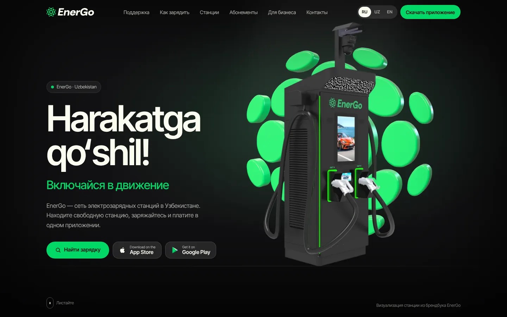
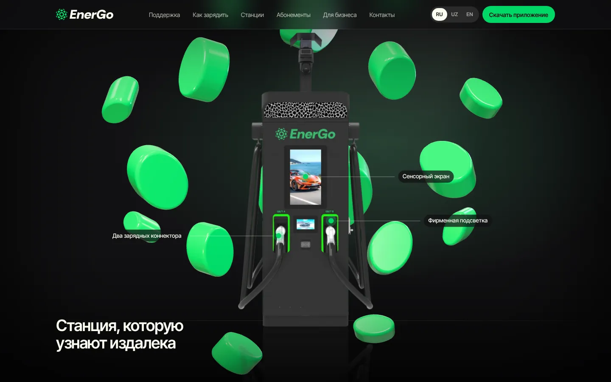
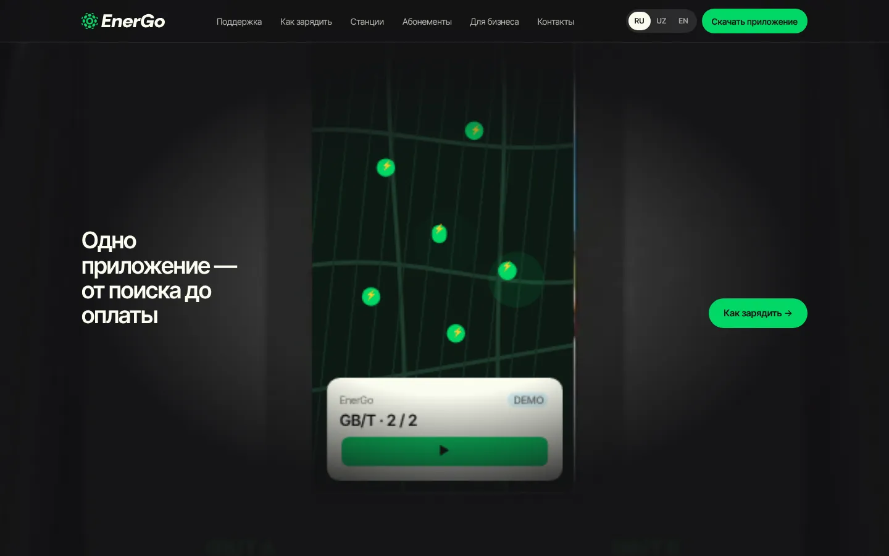

# EnerGo — сайт energocharge.uz (редизайн 2026)

Новый публичный сайт сети зарядных станций EnerGo (Узбекистан). Репозиторий передаётся команде продукта для доведения до продакшена.

> **Статус:** рабочий прототип первой версии главной страницы. Дизайн ещё **не утверждён** заказчиком, на боевой домен не публиковался. Все места с непроверенными данными помечены в интерфейсе бейджем `DEMO` и перечислены в [docs/INTEGRATIONS.md](docs/INTEGRATIONS.md).

## Скриншоты

| Первый экран | Кадр 2 | Кадр 3 |
|---|---|---|
|  |  |  |

Остальные разделы и мобильная версия — в [docs/screenshots](docs/screenshots).

## Стек

| Что | Зачем |
|---|---|
| [Next.js 15](https://nextjs.org/) (App Router, SSG) + TypeScript | статическая генерация страниц на каждом языке, SEO, быстрый первый экран |
| [Tailwind CSS 4](https://tailwindcss.com/) | дизайн-токены бренда в `src/app/globals.css` (`@theme`) |
| [Motion](https://motion.dev/) (Framer Motion) | скролл-режиссура, переходы, микро-анимации |
| [three.js](https://threejs.org/) | 3D-знак EnerGo в первом экране (WebGL, только десктоп) |
| `next/font` → Inter Tight | фирменный шрифт по брендбуку |

Требования: Node.js 20+ (см. `.nvmrc`), npm.

## Запуск

```bash
npm install
npm run dev          # http://localhost:3000  → редирект на /ru
npm run build        # продакшен-сборка
npm start            # запуск собранного сайта
npm run typecheck    # проверка типов
npm run lint

STATIC_EXPORT=1 npm run build   # чистая статика в ./out (любой хостинг/CDN)
```

Страницы: `/ru`, `/uz`, `/en`. Корень `/` перенаправляет на `/ru`.

## Структура

```
public/
  brand/            оригинальный логотип EnerGo (4 версии из брендбука) + знак
  media/            рендеры станций, навеса и авто из брендбука (WebP с прозрачностью)
src/
  app/
    [locale]/       layout (шрифт, SEO, hreflang) и главная страница
    globals.css     дизайн-токены бренда и базовые компоненты (.btn-*, .card, .eyebrow)
  components/
    hero/           первый экран: Hero (скролл-сцена), MarkScene (WebGL), ScreenUI
    sections/       Header, Support, HowTo, Stations, Club, Business, AppBand, Footer
    ui/             Logo, Reveal, SectionHeading, StoreButtons
  data/
    club.ts         пакеты EnerGo Club (из драфта команды — сверить!)
    stations.demo.ts демо-станции (не реальные!)
  i18n/
    config.ts       список языков
    dictionaries/   ru.ts (эталон), uz.ts, en.ts — все тексты сайта
  lib/
    site.ts         все внешние ссылки и контакты в одном месте
docs/
  DESIGN.md         арт-дирекшн, раскадровка первого экрана, правила бренда
  INTEGRATIONS.md   что подключить и что проверить перед запуском
```

## Правила бренда (не нарушать)

Источник — брендбук `Energo Guideline.pdf` (22 стр.).

- **Логотип** — только файлы из `public/brand/`. Они извлечены из брендбука (стр. 6) без изменений геометрии. Не перерисовывать, не менять пропорции, соблюдать охранное поле (стр. 4–5). Версия выбирается по фону: `green` — светлый, `white` — Malachite, `dark` — Chinese Black, `blue` — Non-Photo Blue.
- **Палитра** (стр. 7): Floral White `#FAFCF0`, Malachite `#02D866`, Chinese Black `#131214`, Non-Photo Blue `#98DAF7`. В брендбуке у Non-Photo Blue RGB напечатан как `52 218 247`, что не совпадает с HEX; используем HEX, расхождение нужно сверить с дизайнером бренда.
- **Шрифт** (стр. 8): Inter Tight.
- **Станции**: только реальные рендеры из брендбука (стр. 9–13). На сайте они подписаны как визуализация из брендбука.
- **Слоган**: `Harakatga qo‘shil!` / «Включайся в движение».

## Как добавить или поменять текст

Все тексты — в `src/i18n/dictionaries/`. `ru.ts` задаёт структуру, `uz.ts` и `en.ts` типизированы по ней: если забыть ключ, сборка упадёт. Узбекский — латиница. Переводы uz/en черновые, нужна вычитка носителями.

## Производительность и доступность

- WebGL-сцена грузится динамически, только на экранах ≥1024×640 и без `prefers-reduced-motion`. На телефонах и при reduced-motion — лёгкая статичная версия первого экрана без three.js.
- Рендер 3D останавливается, когда первый экран не виден; pixel ratio ограничен 1.75.
- Карта Яндекса загружается только по клику, чтобы не тормозить страницу.
- Есть skip-link, видимый фокус, `aria-*` у меню, аккордеонов и переключателей.

## Деплой

Сайт полностью статический. Варианты: Vercel/Netlify «из коробки» или `STATIC_EXPORT=1 npm run build` и выкладка `out/` на любой веб-сервер/CDN. Публикация на energocharge.uz — отдельное решение заказчика.
